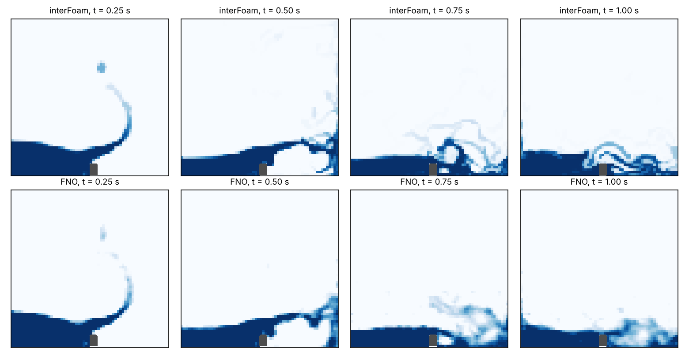
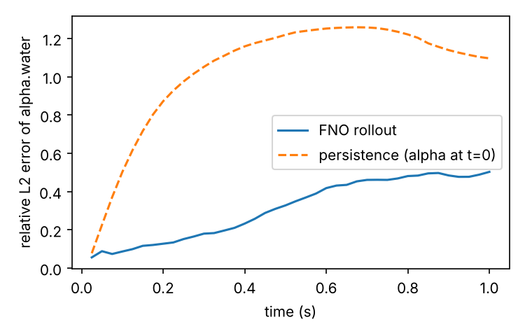

# Two-Phase Dam Break with an Autoregressive FNO

This example trains a Fourier Neural Operator (FNO) to roll out a two-phase,
free-surface flow: the collapse of a water column onto an obstacle, the
classic OpenFOAM `damBreak` tutorial solved with `interFoam` (volume of fluid).
It covers the full loop from a CFD solver to a surrogate:

1. generate a parametric dataset with OpenFOAM,
2. train an autoregressive FNO on the water volume fraction `alpha.water`,
3. roll the model out from the initial condition alone and compare it with
   `interFoam` on held-out cases.



## Problem

The domain is the square tank of the `damBreak` tutorial (0.584 m side) with a
small obstacle on the floor. At t = 0 a rectangular column of water sits at
rest against the left wall. Each sample changes the column's width and
height:

| parameter | range |
| --- | --- |
| column width | 0.08 m to 0.20 m |
| column height | 0.15 m to 0.45 m |

The flow is followed for 1 s, which includes the impact on the right wall and
the splash back over the obstacle.

## Dataset

`generate_dataset.py` copies the tutorial, refines its mesh by a factor of 2
(9072 cells), sets the column size in `setFieldsDict` and runs `blockMesh`,
`setFields` and `interFoam`. `alpha.water` is written every 0.025 s (41
frames) and sampled onto a uniform 64 x 64 grid. The obstacle is stored as a
mask. The script checks that the cell centres it computes from the
`blockMeshDict` match the cells `setFields` filled, so the mapping from the
mesh to the grid is verified for every case.

```bash
# OpenFOAM v1912 or newer (Ubuntu: sudo apt-get install openfoam openfoam-examples)
source /usr/share/openfoam/etc/bashrc    # or your OpenFOAM installation's bashrc
pip install -r requirements.txt
python generate_dataset.py --num-cases 100 --output-dir ./data
```

If `$FOAM_TUTORIALS` is not set, pass the tutorial directory with
`--template <path>/multiphase/interFoam/laminar/damBreak/damBreak`. The 100
cases took 1273 s on a 4-core CPU with 4 workers, and the three HDF5 files
(80 training, 10 validation and 10 test cases) take 42 MB.

The grid is coarser than thin films and droplets after the splash, so the
water volume on the grid is not exactly conserved even though `interFoam`
conserves it: over the 1 s, the gridded volume changes by at most 8.7 % in the
training cases and 10.8 % in the test cases.

## Model and training

The FNO (`physicsnemo.models.fno.FNO`, 4 layers, 16 modes, 32 latent channels,
4.2 M parameters) takes `alpha` at t - dt and t and the obstacle mask, and
predicts the update to t + dt. The second input frame gives the model the
motion of the interface, which a single frame does not carry. Predictions are
clamped to [0, 1] and set to zero inside the obstacle.

To keep long rollouts stable, training unrolls the model for 4 steps on its own
predictions and back-propagates through all of them. The loss is the mean
squared error over the unrolled frames.

```bash
python train.py data.dir=./data
python inference.py data.dir=./data
```

`train.py` logs the full-rollout error on the validation cases every 5 epochs.
`inference.py` writes `metrics.json`, `rollout.png` and `error_vs_time.png`
to `outputs/`.

## Results

Measured on the 10 test cases with the default configuration, after 40 epochs
on CPU (4574 s of training on 4 cores). Each rollout starts from the initial
condition only and runs the 40 steps to t = 1 s.

| metric | FNO | persistence (alpha at t = 0) |
| --- | --- | --- |
| relative L2 error, mean over the rollout | 0.312 | 1.037 |
| relative L2 error at t = 1 s | 0.503 | |
| IoU of the wet region (alpha > 0.5), mean over the rollout | 0.814 | |
| IoU of the wet region at t = 1 s | 0.635 | |
| water volume error at t = 1 s (mean absolute) | 12.2 % | |

The rollout of all 10 test cases takes 2.7 s on the same CPU, against about
51 s of CPU time per case for `interFoam` on the refined mesh.



The model follows the collapse, the surge along the floor and the jet up the
right wall closely; the error stays below 0.2 until about 0.35 s. After the
wave breaks, the FNO smooths the thin sheets and droplets of the splash into
a diffuse region, the error grows to about 0.5 and the water volume drifts.
These are the usual limits of a grid-based, autoregressive surrogate of a
sharp interface, and natural directions to extend the example: a finer grid,
more training cases, longer unrolls, or a loss that conserves the volume.

## Files

| file | content |
| --- | --- |
| `generate_dataset.py` | runs the OpenFOAM cases and writes the HDF5 dataset |
| `utils.py` | dataset windows, model construction and the rollout |
| `train.py` | unrolled autoregressive training |
| `inference.py` | test rollout, metrics and figures |
| `config.yaml` | model, training and inference settings |

## References

- Z. Li et al., *Fourier Neural Operator for Parametric Partial Differential
  Equations*, ICLR 2021.
- OpenFOAM `damBreak` tutorial, based on J. C. Martin and W. J. Moyce,
  *An experimental study of the collapse of liquid columns on a rigid
  horizontal plane*, Phil. Trans. R. Soc. Lond. A 244, 1952.
